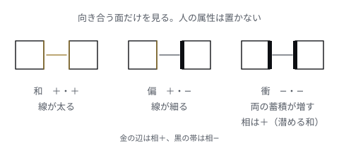
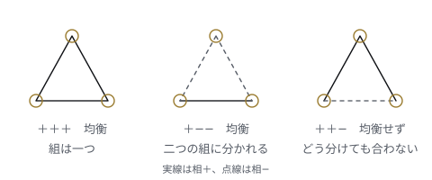

# 原理：魔法使いの定義と法則

PRINCIPIA MAGI OCCULTI · ステルス・ウィザード

> [!NOTE]
> **娯楽の枠**　これは運営者の学術的な活動とは別の、エンターテインメントの枠です。科学ではありません。
>
> これは遊びです。運営者の学術的な活動とは別の、エンターテインメントの枠です。科学ではありません。都市伝説を題材にした娯楽の頁で、ここに書く法則は科学の法則ではなく、誰の性経験も評価せず、特定の人を指しません。内輪ノリであり、気分を害する方がいる可能性があります。ご注意ください。選民思想ではなく、運営者は魔法使いの代表ではありません。

この文書は、サイト「ステルス・ウィザード」の [原理](https://quiet-wizard.vercel.app/strict.html) の頁と同じ中身を、GitHub で読める形にしたものです。

原典は、こう始まります。

> 本稿は論文とは別のものであり、著者の主体的な直観によるものである。

## 目次

1. [第一巻　定義](#s1)
2. [要請](#s2)
3. [公理、すなはち法則](#s3)
4. [定理](#s4)
5. [注解](#s5)
6. [第二巻　式](#s6)
7. [後定理と形の定理](#s7)
8. [第三巻　関係の体系](#s8)
9. [第四巻　魔法とは何か](#s9)
10. [総注解](#s10)

> これは遊びです。原典の定義九つと法則十を骨にして、古典の数学書の形で組み直した版です。
>
> 「厳密」なのは言葉の運びのことで、中身が科学として正しいという意味ではありません。何も測っておらず、確かめてもいません。
>
> この版は、運営者の求めで Claude が書いたものです。原典ではありません。原典の文は、[原典](src/canon.md)の頁に手を入れずに置いてあります。

第一巻は、原典にある定義九つと法則十に、一つずつ対応します。\
定義十と、要請二つは、この版で補ったものです。\
第二巻は、第一巻の定義と法則を多ソートの一階の述語論理の式に移し、法則の体系についての定理と、形についての定理を証します。\
第三巻は、人と人との関係の力学を、向き合う面として記します。\
第四巻は、魔法とは何かを定め、その性質を証します。\
原典にある項には、この版の文を文語で掲げ、その下に原典の文を「原文」として、手を入れずに添えます。\
並びは、ニュートン『自然哲学の数学的原理』の「定義」「公理、すなわち運動の法則」と、ユークリッド『原論』の定理と証明に倣いました。

## 第一巻　定義 LIBER I · DEFINITIONES

**定義一　魔法使ひ**\
魔法使ひとは、自らの負と正とを併せ用ゐて能動し、成果を出だす者を謂ふ。その負と正とは、同じ要素の、時を異にする面なるも妨げず。

> **原文**　自らの負と正の両方を用いて能動し、成果を出す者をいう。

**定義二　童貞**\
童貞とは、性経験なき者を謂ふ。いづれの時までかは、用ゐる所にて定む。この語は事実を指すのみにして、人の値を指さず。

> **原文**　性経験のない者をいう。

**定義三　能動**\
能動とは、人の為す凡ての行ひを謂ふ。発信・記録・働きかけは、その一部に過ぎず。

> **原文**　全ての能動をいう。発信、記録、働きかけに限らない。

**定義四　成果**\
成果とは、能動より生ずるものを謂ふ。その形は、時と場合とに由りて定まる。

> **原文**　能動によって生じるものをいう。その形は時と場合によって定まる。

**定義五　要素**\
要素とは、人を成すものを謂ふ。凡そ要素は、五つの正多面体のいづれかの形を具ふ。

> **原文**　ある者を構成するものをいう。要素は正多面体である。

**定義六　負と正**\
負と正とは、要素が時と場合とに応じて向くる面の相を謂ふ。要素それ自らに負と正との別なし。面の負正もまた、時と場合とを得て始めて定まる。

> **原文**　要素が時と場合によって向ける面をいう。要素そのものに負と正の別はない。

**定義七　蓄積**\
蓄積とは、負の消えずして積もり行くことを謂ふ。その量は、負を向けたる度の数を以て量る。

> **原文**　負が消えずに溜まっていくことをいう。

**定義八　切り替はり**\
切り替はりとは、積もれる負が、その面の逆を正として顕し始むることを謂ふ。始めて顕るる時を、切り替はりの時と名づく。

> **原文**　蓄積した負が、逆の面を正として顕し始めることをいう。

**定義九　三十歳**\
三十歳とは、切り替はりの目安を謂ふ。目安は時を定めず。

> **原文**　切り替わりの目安をいう。

**定義十　逆**\
面の逆とは、多面体の中心について、その面と点対称の位に在る面を謂ふ。正四面体にはかかる面なきが故に、その面に向かひ合ふ頂点を以て逆と為す。この頂点もまた、面に準じて負と正とを帯ぶ。

> **原文**　なし（この版にて補ふ）

## 要請 POSTULATA

**要請一　時**\
時は前へのみ進む。過ぎたる出来事は、取り消さるることなし。

**要請二　値**\
人の値は、魔法使ひたると否と、童貞たると否とに由らず。

## 公理、すなはち法則 AXIOMATA, SIVE LEGES

**第一法則　成立** LEX I · CONSTITUTIO\
三十歳に至るまで童貞なる者は、いつか必ず魔法使ひと成る。その時の、三十歳の前なるも後なるも妨げず。

> **原文**　三十歳まで童貞であれば、魔法使いになる。

**第二法則　多面** LEX II · MULTIPLICITAS\
要素は定まらず。時と場合とに由りて、向くる面を変ふ。

> **原文**　要素は固定されない。時と場合によって、向く面を変える。

**第三法則　保存** LEX III · CONSERVATIO\
負は滅せず、積もる。一たび向けたる負は取り消されず、蓄積は減ずることなし。

> **原文**　負は消えない。蓄積する。

**第四法則　反転** LEX IV · CONVERSIO\
負の蓄積進みて、その人の閾に達すれば、かつて負を向けたる面の逆、正として顕る。

> **原文**　負の蓄積が進めば、逆の面が正として顕れる。

**第五法則　目安** LEX V · NORMA\
三十歳は目安に過ぎず。切り替はりは、その齢に先だつこともあり。

> **原文**　三十歳は目安にすぎない。切り替わりは年齢に先立つことがある。

**第六法則　還元** LEX VI · RESTITUTIO\
成果は、出づるその時に、人の関係へ事もなく還る。故に外よりは見えず。

> **原文**　成果は、出た瞬間に社会的関係へ何事もなく還元される。ゆえに外からは見えない。

**第七法則　共通** LEX VII · COMMUNITAS\
成れる者は、皆これを行ふ。すなはち、魔法使ひと成りし後は、命ある限り、成果を生む能動を止めず。

> **原文**　成った者は、皆これを行っている。

**第八法則　泥沼** LEX VIII · PALUS\
成れば泥沼なり。成りし後、脳は止まず。

> **原文**　成れば泥沼である。脳は止まらない。

**第九法則　秘匿** LEX IX · ARCANUM\
具体を記せば、記したる者に害返る。故に具体は記さず。

> **原文**　具体を記せば、記した者に害が返る。ゆえに具体は記さない。

**第十法則　長命** LEX X · LONGAEVITAS\
成るは、長く生くることなり。長く生くるは難し。その労は、生きたる長さと共に増す。

> **原文**　成ることは、長く生きることである。長く生きるのは大変である。

*注*　ここに長く生くとは遊びの語にして、身体の寿命を言ふにあらず。

## 定理 PROPOSITIONES

**定理一　魔法使ひたるか否かは、成果を以て外より見分くるを得ず。**\
*証明*　第六法則により、成果は外より見えず。しかるに定義一は、成果を出だすことを求む。故に外よりは、この条件を成果を以て確かむるを得ず。*Q.E.D.*

**定理二　第一法則は足る条件にして、要る条件にあらず。すなはち、童貞ならざる者も魔法使ひたり得。**\
*証明*　童貞を条件とするは第一法則のみにして、それも童貞なる者の行く末を述ぶるに止まる。定義一は童貞を含まず。現に、第二巻の模型 M₀′ にては、x は童貞ならずして、時二十一にて魔法使ひと成り、いづれの法則にも背かず（定理十）。故に、童貞ならざる魔法使ひあり得。*Q.E.D.*

**定理三　この法則は、三十歳の誕生日に何事かの起こるを言はず。**\
*証明*　第一法則は、いつか必ず成ると言ふのみにして、その時の三十歳の前なるも後なるも妨げず。第五法則もまた、三十歳を目安と言ふのみ。定義九により、目安は時を定めず。*Q.E.D.*

**定理四　この法則は、外より成果を観て反証するを得ず。**\
*証明*　第一法則の外れたる例を示すには、三十歳に至るまで童貞なる者の、魔法使ひと成らざることを示さざるべからず。しかるに第六法則により、成果は外より見えず。成果の見えざるは、成らざるの証とならず。故に、外より成果を観て、外れたる例を示すを得ず。*Q.E.D.*\
*注*　この法則の、科学の法則にあらざる所以の一つ、ここに在り。式の上の証は、第二巻の定理十一に在り。

**定理五　魔法使ひは、他の人に優るにあらず。**\
*証明*　要請二により、人の値は魔法使ひたると否とに由らず。故に、魔法使ひたることより、人の上下を導くを得ず。*Q.E.D.*\
*注*　ここに優るにあらずとは、魔法使ひたるが故に優るにあらざるを謂ふ。

**定理六　正四面体の面の逆は、頂点なり。**\
*証明*　正四面体の中心を原点に置けば、四つの頂点の和は零なり。一つの面の中心は残る三つの頂点の平均なれば、その面に向かひ合ふ頂点を v とするとき、−v/3 なり。すなはち面の中心は、四つの頂点の各々の −1/3 倍なり。これを中心について点対称に移せば v/3 となる。v に点対称なる頂点なきが故に、v/3 はいづれの面の中心にも等しからず。故に正四面体には逆の面なく、定義十により、逆は向かひ合ふ頂点なり。他の四つの正多面体は中心について点対称なれば、いづれの面にも逆の面あり。*Q.E.D.*

**定理七　面の数 n なる要素にて、面ごとの負正の割り当ては 2ⁿ 通りなり。**\
*証明*　各面に負と正との二つあり。面の数 n なれば、割り当ては 2ⁿ 通りなり。正二十面体は面二十なれば、2²⁰ すなはち 1,048,576 通りなり。*Q.E.D.*

## 注解 SCHOLIUM

- 凡そ正多面体の五つに限ることは、ユークリッド『原論』第十三巻の終はりに証せらる。プラトンの『ティマイオス』に因みて、プラトンの立体とも呼ばる。
- この版の並びは、ニュートン『自然哲学の数学的原理』（一六八七年）に倣ふ。かの書は、定義と、それに続く注解との次に「公理、すなはち運動の法則」を置き、法則の後に系と注解とを置く。
- この版にて補へるもの：定義一の後段（時を異にする面）、定義二の時の限りと値の語、定義六の面の負正、定義七の量、定義八の時の名、定義九の後段、定義十（逆と、その頂点の負正）、要請一・二、第一法則の「いつか必ず」と時の前後、第四法則の閾、第七法則と第八法則の「成りし後」の読み、第十法則の労の増し方と注。いづれも原典に無く、Claude の書けるものなり。

## 第二巻　式 LIBER II · FORMULAE

第二巻では、第一巻の定義と法則を、多ソートの一階の述語論理の式に移す。時の ℕ と、数を数える # は、通常の意味で解する。\
式に移すとき、言葉の幅は一つの読みに定まる。どう読んだかは、総注解にすべて挙げる。\
模型が法則を満たすか、そして数は、verification/models.js が機械で確かめている。定理十一と、群の同型は、手の証明による。

| 記号 | 意味 |
| --- | --- |
| x, y ∈ P | 人。P は有限 |
| t, s ∈ ℕ | 時。齢の年で数える。x は t ≤ L(x) のあいだ生きている |
| c ∈ C | 場面。C は有限で、空でない |
| e ∈ E(x) | x の要素。五つの正多面体のいずれかの形を持つ。U(e) は e の面の全体で、正四面体では面と頂点の全体。要素が違えば U(e) は互いに素とする |
| ι | 逆（定義十）。U(e) の上の対合で、面をその逆の面に、正四面体では面を向かい合う頂点に、頂点を向かい合う面に移す。ι(u) ≠ u |
| φ(e, t, c) ∈ U(e) | 時 t、場面 c で、e が向ける面 |
| σ(u, t, c) ∈ {−, +} | u の、時 t、場面 c での相 |
| H(x, t) | 負を向けた出来事の歴史。e ∈ E(x)、s ≤ t、c ∈ C、σ(φ(e, s, c), s, c) = − となる (e, s, c) の全体 |
| N(x, t) ⊆ H(x, t) | 蓄積に残る出来事。A(x, t) = #N(x, t)（定義七）。κ(x) ≥ 1 は閾 |
| Act(x) | x の能動。能動 a は、時 τ(a) ≤ L(x)、用いる向きの集まり Use(a)（みな x の要素の向きで、その時はみな τ(a) 以前）、成果の集まり R(a) を持つ |
| W(x, t) | 魔法使い。τ(a) ≤ t、R(a) ≠ ∅ で、Use(a) に負の向きと正の向きがともにある能動 a があること（定義一） |
| Sw(x, t) | 切り替わり。(e, s, c) ∈ N(x, t)、s < t で、ある c′ について φ(e, t, c′) = ι(φ(e, s, c)) かつ σ(ι(φ(e, s, c)), t, c′) = + であること（定義八） |
| V(x, t) | t まで童貞（定義二） |
| Rel(x)、Obs | x の関係の中に置かれた成果の全体と、外から見える成果の全体 |
| B(x, t)、Wr(y, r)、Harm(y)、Toil(x, t) | 脳が働くこと、y が成果 r の具体を記すこと、y に害が返ること、労 |
| Λ | 長命の境。模型が定める数で、30 より大きい |

定義六は、次の式になる。\
D6：∀x ∀e ∈ E(x) ∀u ∈ U(e) ∃(t, c) ∃(t′, c′) [σ(u, t, c) = − ∧ σ(u, t′, c′) = +]

| 法則 | 式 |
| --- | --- |
| L1 成立 | ∀x [L(x) ≥ 30 ∧ V(x, 30) → ∃t ≤ L(x) W(x, t)] |
| L2 多面 | ∀x ∀e ∈ E(x) ∃(t, c) ∃(t′, c′) [t, t′ ≤ L(x) ∧ φ(e, t, c) ≠ φ(e, t′, c′)] |
| L3 保存 | ∀x ∀t ≤ L(x) [N(x, t) = H(x, t)] |
| L4 反転 | ∀x ∀t₀ ≤ L(x) [t₀ が A(x, t₀) ≥ κ(x) となる最初の時 → ∃t ∈ [t₀, L(x)] Sw(x, t)] |
| L5 目安 | ∃x ∃t < 30 [t ≤ L(x) ∧ Sw(x, t)] |
| L6 還元 | ∀x ∀a ∈ Act(x) [R(a) ⊆ Rel(x)] ∧ ∀x [Rel(x) ∩ Obs = ∅] |
| L7 共通 | ∀x ∀t [W(x, t) → ∀s ∈ [t, L(x)] ∃a ∈ Act(x) (τ(a) = s ∧ R(a) ≠ ∅)] |
| L8 泥沼 | ∀x ∀t [W(x, t) → ∀s ∈ [t, L(x)] B(x, s)] |
| L9 秘匿 | ∀y ∀r [Wr(y, r) → Harm(y)] |
| L10 長命 | ∀x [∃t W(x, t) → L(x) ≥ Λ] ∧ ∀x ∀s < L(x) [Toil(x, s) < Toil(x, s + 1)] |

外から見えるものは、記号の一部 𝒪 として定める。二つの模型が 𝒪 について等しいとは、𝒪 の記号の解釈が一致することをいう。定理十と定理十一の前半では 𝒪 = {Obs}、定理十一の後半では 𝒪 = {Obs, L, V} とする。

## 後定理と形の定理 METATHEOREMATA ET GEOMETRICA

定理八から十一は、法則の体系そのものについての定理である。定理十二・十三は、正多面体の形についての定理である。

**定理八　定義六と、十の法則とは、相容る。**\
*証明*　次の模型 M₀ を取る。P = {x}、C = {c}、L(x) = 100、Λ = 80、κ(x) = 1、V(x, t) は常に真。E(x) = {e} で、e は正六面体。g、f、f* は e の面で、f* = ι(f)、g はそのどちらとも異なる。φ(e, t, c) は、t < 20 で g、t = 20 で f、t > 20 で f*。σ(u, t, c) は、どの面 u でも、t = 20 で −、ほかで +。N = H。Act(x) = {a_s : 21 ≤ s ≤ 100}、τ(a_s) = s、Use(a_s) = {(e, 20, c), (e, s, c)}、R(a_s) = {r_s}。Rel(x) = {r_s : 21 ≤ s ≤ 100}、Obs = ∅、B は常に真、Wr = ∅、Toil(x, t) = t。このとき H(x, t) は t ≥ 20 で {(e, 20, c)} となり、A は時 20 に初めて閾に達し、Sw(x, t) は t ≥ 21 で成り立ち、W(x, t) は t ≥ 21 で成り立つ。D6 と L1〜L10 のそれぞれに代入すれば、すべて真となる。*Q.E.D.*

**定理九　十の法則は、互いに独立なり。いづれの一つも、他の九つと定義六とより導かれず。**\
*証明*　k = 1, …, 10 の各々に、L_k だけを偽とし、D6 と他の九つを真とする模型 M_k を、M₀ に手を加えて作る。M_k が L_k を満たさず、残りを満たすので、L_k は残りから導かれない。*Q.E.D.*

| 模型 | M₀ に加える手 | 偽となる所 |
| --- | --- | --- |
| M₁ | 人 y を足す。L(y) = 100、V(y, t) は常に真、κ(y) = 2、要素は正六面体一つで、時の偶奇で二つの面を交互に向ける。N = H、Act(y) = ∅、Rel(y) = ∅、B(y, t) は常に真、Toil(y, t) = t | y は三十歳まで童貞だが、魔法使いと成らない。y の蓄積は 1 で、閾 2 に届かないので、L4 は保たれる |
| M₂ | x に、向ける面が常に同じ正六面体 e′ を足す | e′ の向きが変わらない |
| M₃ | t > 50 で N(x, t) = ∅ とする | 時 51 に、蓄積から出来事が消える |
| M₄ | x は t > 20 でも f を向け続ける。M₀ の x の写し z を足す | x は閾に達したが、逆が顕れない。z が L5 を保つ |
| M₅ | φ は t < 40 で g、t = 40 で f、t > 40 で f*。σ は t = 40 で −。Act(x) = {a_s : 41 ≤ s ≤ 100}、Use(a_s) = {(e, 40, c), (e, s, c)} | 切り替わりが時 41 で、三十より前の例がない |
| M₆ | Obs = {r₂₁} | 成果が外から見える |
| M₇ | Act(x) = {a₂₁} | 時 22 から、成果を生む能動がない |
| M₈ | B(x, 50) を偽とする | 時 50 に脳が止まる |
| M₉ | Wr = {(x, r₂₁)}、Harm = ∅ | 具体を記したのに、害が返らない |
| M₁₀ | L(x) = 50、Act(x) = {a_s : 21 ≤ s ≤ 50} | 魔法使いが Λ = 80 に届かない |

**定理十　外より見ゆるものを等しくして、魔法使ひたると否とを異にする二つの模型あり。**\
*証明*　M₀′ を、M₀ で V(x, t) を常に偽としたものとする。M₀⁻ を、M₀′ から能動を除いたもの（Act(x) = ∅、Rel(x) = ∅）とする。どちらも V が偽なので、L1 は空虚に真となる。M₀⁻ では W が偽なので、L7・L8 も空虚に真となる。切り替わりは両方に残るので、L4・L5 も真。ゆえに両者は D6 と十の法則を満たす。Obs はともに空で、𝒪 = {Obs} について等しい。しかし W(x, 100) は、M₀′ で真、M₀⁻ で偽である。また M₀′ で、x は童貞でないまま魔法使いになる。これが第一巻の定理二の、式の上の証である。*Q.E.D.*

**定理十一　生きたる長さを外より見えざるものとすれば、外より見ゆるもののいかなる記録も、第一法則を反証せず。生きたる長さと童貞とを外より見ゆるものとすれば、反証は得らる。**\
*証明*　前半（𝒪 = {Obs}）。M を、第一法則のほかの九つと D6 とを満たす模型とし、三十歳まで童貞で、生きているあいだに魔法使いと成らない人を x とする。x の内のものを、次のように取り替える。L(x) を、100 と M の Λ との大きいほうとする。E(x)、φ、x の面の σ、N、κ を M₀ の x と同じにし、φ と σ はどの場面でも同じとする。Act(x) を {a_s : 21 ≤ s ≤ L(x)} とし、成果 r_s は、Obs にも、ほかの人の成果にもない新しいものとする。Rel(x) をその成果の全体とし、B(x, t) を常に真、Toil(x, t) = t とする。V(x)、ほかの人、Obs、Wr、Harm は残す。取り替えた x は M₀ の x と同じく時 21 から魔法使いで、L(x) ≥ Λ なので L10 を満たし、ほかの法則も満たす。これを、そうした人のすべてに行えば、𝒪 について M と等しい模型で、第一法則が成り立つ。ゆえに Obs のどの記録も、第一法則の成り立つ世界と成り立たない世界とを分けない。\
後半（𝒪 = {Obs, L, V}）。V(x, 30) が真で、L(x) = 30 の人が一人でもいれば、Λ > 30 なので、L10 により x は魔法使いでない。すると L1 に反する。ゆえに、この観測は第一法則と第十法則の組を反証する。*Q.E.D.*\
*注*　この版は、第一巻の第十法則の注から、L を外より見えざるものと読む。そう読むことで、後半の帰結は断たれる。後半の帰結は身体の寿命についての主張になるので、この遊びは、注によって、それを主張しない。

**定理十二　正多面体のいづれの面にも逆の面あるは、その対称の群に中心反転 −I の属する時、かつその時に限る。五つの中、これを欠くは正四面体のみ。**\
*証明*　−I が対称の群 G に属するとする。−I は面を面に移し、面の中心 p を −p に移すので、−p を中心とする面が、p の面の逆である。逆に、どの面にも逆があるとする。すると、面の中心の集まり S は −S に等しい。多面体は、面の中心 p ごとの半空間 {y : ⟨y, p⟩ ≤ ⟨p, p⟩} の共通部分である。S を自らに移す直交変換は、この共通部分を自らに移すので、G に属する。−I は S を自らに移すので、G に属する。正四面体では、定理六により −p はどの面の中心でもない。ゆえに、その対称の群 T_d ≅ S₄（位数 24）は −I を含まない。正六面体と正八面体の群 O_h ≅ S₄ × C₂（位数 48）、正十二面体と正二十面体の群 I_h ≅ A₅ × C₂（位数 120）は、−I を含む。*Q.E.D.*

**定理十三　回転にて重なる割り当てを同じと見れば、面ごとの負正の割り当ては、正四面体 5、正六面体 10、正八面体 23、正十二面体 96、正二十面体 17,824 通りなり。**\
*証明*　バーンサイドの補題により、数は回転の群 G⁺ での平均 (1/#G⁺) Σ_g 2^{c(g)} に等しい。c(g) は、g が面に作る巡回の数である。回転の群の位数は、順に 12、24、24、60、60。\
正四面体：(2⁴ + 8·2² + 3·2²)/12 = 60/12 = 5。\
正六面体：(2⁶ + 6·2³ + 3·2⁴ + 8·2² + 6·2³)/24 = 240/24 = 10。\
正八面体：(2⁸ + 6·2² + 3·2⁴ + 8·2⁴ + 6·2⁴)/24 = 552/24 = 23。\
正十二面体：(2¹² + 24·2⁴ + 20·2⁴ + 15·2⁶)/60 = 5,760/60 = 96。\
正二十面体：(2²⁰ + 24·2⁴ + 20·2⁸ + 15·2¹⁰)/60 = 1,069,440/60 = 17,824。*Q.E.D.*

## 第三巻　関係の体系 LIBER III · DE SYSTEMATE RELATIONUM

第三巻では、人と人との関係の力学を、多面体の向き合いとして記す。\
人を点、関係を線とし、線の両端で向き合う面の相だけを見る。人の属性は、どこにも置かない。\
この巻の定義十一から十四と、要請三・四は、いずれもこの版で補ったものである。\
第三巻の要請は、第二巻の式の外にある。第二巻の定理八から十一は、第三巻の要請を加えた世界については何も主張しない。線の太さは、第二巻の Obs に入れない。

**定義十一　界面**\
界面とは、時と場合とにて、x が y に向くる面と、y が x に向くる面との対を謂ふ。場合ごとに相手は一人とし、x の要素の一つがその相手に面を向く。

> **原文**　なし（この版にて補ふ）

**定義十二　界面の相**\
界面の相とは、両の面の相の積を謂ふ。正と正、負と負とは正、正と負とは負なり。

> **原文**　なし（この版にて補ふ）

**定義十三　和・偏・衝**\
正と正との界面を和、正と負との界面を偏、負と負との界面を衝と名づく。衝の相は正なり。これを潜める和と謂ふ。

> **原文**　なし（この版にて補ふ）

**定義十四　関係の網**\
関係の網とは、人を点とし、関係を線とする網を謂ふ。線は太さと相とを持つ。線の相は、その界面の相なり。

> **原文**　なし（この版にて補ふ）

図6 和・偏・衝：向き合う面の相（遊び）

**要請三　力**\
和は線を一つ太らせ、偏は線を一つ細らす。ただし太さは零を下らず。衝は太さを動かさず。いづれの界面にても、負を向けたる側の蓄積は一つ増す。

**要請四　還元の流れ**\
x の成果は、x の隣る者を一方の端とし、x を端とせざる線を太らす。

衝を「潜める和」と呼ぶのは、二つの理由による。\
第一に、負と負との積は正である。第二に、要請三により、衝は両の端の蓄積を増す。場合ごとに相手は一人なので、要素が一つの者では、この増え方は、第二巻の歴史 H の数え方と一致する。第四法則により、蓄積が閾に達した者には、かつて負を向けた面の逆が正として顕れる。二人が互いに、かつての負の面の逆を向け合えば、その界面は和となる。

**定理十四　形は差を生まず。五つの正多面体の回転の群は、いづれも面の上に推移的に働く。故に、同じ形の要素の間にては、界面を分くるは面の位にあらず、相のみなり。**\
*証明*　軌道と安定化群の定理により、一つの面の軌道の大きさは、群の位数を、その面を留める回転の数で割ったものに等しい。面を留める回転は、面の中心を通る軸の周りの回転で、その数は面の辺の数に等しい。位数と面の数と辺の数は、正四面体 12 = 4 × 3、正六面体 24 = 6 × 4、正八面体 24 = 8 × 3、正十二面体 60 = 12 × 5、正二十面体 60 = 20 × 3。ゆえに一つの面の軌道は面の全体であり、どの面も回転で他のどの面へも移る。同じ形の要素どうしの二つの界面は、向き合う面を回転で重ね合わせられるので、面の位による別を持たない。残る別は、定義十三の相だけである。違う形の要素どうしの界面も、定義十三は相だけで分ける。*Q.E.D.*\
*注*　どの形の要素を持つ者も、形によって関係において優ることはない。これは要請二と合う。

**定理十五　五つの正多面体は、いづれも、頂点の数より辺の数を引き、面の数を足して、二となる。**\
*証明*　頂点・辺・面の数を数える。辺の数は、面の数と一つの面の辺の数との積の半分である。\
正四面体：4 − 6 + 4 = 2。\
正六面体：8 − 12 + 6 = 2。\
正八面体：6 − 12 + 8 = 2。\
正十二面体：20 − 30 + 12 = 2。\
正二十面体：12 − 30 + 20 = 2。*Q.E.D.*

**定理十六　正六面体と正八面体、正十二面体と正二十面体とは、互ひに双対にして、面と頂点との数を取り替へ、辺の数と回転の群とを同じくす。正四面体は、自らの双対なり。**\
*証明*　双対の位置に置けば、一方の面の中心は、他方の頂点を指す。ゆえに面の数と頂点の数が入れ替わる。辺は、隣り合う二つの面の中心を結ぶ辺と一つずつ対応するので、数が等しい。双対の位置では、二つは同じ点の集まりを保つ回転を共有するので、回転の群も等しい。ほかの位置では、群は互いに共役となる。正四面体の面の中心は −v の向きを指し、これはまた正四面体の頂点をなす。*Q.E.D.*\
*注*　双対の二人では、一方の面が、他方の頂点に向き合う。遊びの言葉で、これを鏡の関係と呼ぶ。

図7 均衡する三人と、均衡しない三人（遊び）

**定理十七　関係の網の閉路は、その線の相の積が正なる時、均衡すと謂ふ。凡ての閉路の均衡するは、人を二つの組に分けて、組の内の線の相が正、組の間の線の相が負となる時、かつその時に限る。組の一方は空なるも妨げず。**\
*証明*　線の相は、ある時と場合を一つ定めて見る。十分であること。どの閉路も、組の境を偶数回渡る。ゆえに負の線は偶数本で、積は正となる。必要であること。網の連結成分ごとに一人 r を取る。各人 x に、r から x への道の線の相の積を与える。二つの道は合わさって閉じた道をなす。閉じた道は、二度通る線を除けば閉路に分かれ、二度通る線は積を変えない。閉路はみな均衡するので、この積は道によらない。積が正の者と負の者とに分ければ、線 xy の相は、x に与えた積と y に与えた積との積に等しい。ゆえに、組の内の線は正、組の間の線は負となる。連結成分ごとに分けた組を合わせれば、網全体の二つの組を得る。*Q.E.D.*\
*注*　この定理は、ハイダー（1946）の均衡の考えを、ハラリ（1953）とカートライトとハラリ（1956）が網の上に定めたもの（構造均衡定理）である。ハイダーでは、互いに嫌う関係は負である。ここでは衝の相を正と定めたので、その点で離れる。衝の線の相は正なので、互いに負を向け合う二人は、同じ組に立つ。組は線の相から定まる形の上のものであり、人の属性にはよらない。

**定理十八　輪の形の網にて、人の四人以上なる時、成果によりて太りたると知れたる線を一つ見るのみにては、その源を一人に定むるを得ず。**\
*証明*　要請四により、線 yz を太らせる源は、y か z に隣り、線の端ではない者である。四人以上の輪では、y の隣のうち z でない者と、z の隣のうち y でない者とは、別の二人である。どちらを源としても、要請四に合う。ゆえに、一つの線からは、源が二人に残る。*Q.E.D.*\
*注*　三人の輪では、この二人が同じ一人となり、成果によって太ったと知れていれば、源は定まる。線は和によっても太るので、そう知れていない時は、三人でも定まらない。また要請四により、x の成果は x を端とする線を太らせないので、x 自身の線は、x の成果によっては太らない。

## 第四巻　魔法とは何か LIBER IV · DE MAGIA

原典は魔法使いを定めるが、魔法そのものは定めない。\
第四巻は、定義一（負と正とを併せ用いる能動）、定義八（逆を正として顕すこと）、第六法則（関係への還元と、外から見えないこと）の三つが一つの働きを指していると読み、その働きを魔法と名づける。\
この巻の定義十五・十六は、この版で補ったものである。

**定義十五　転化**\
転化とは、かつて負を向けたる面の逆を、のちに正として用ゐることを謂ふ。

> **原文**　なし（この版にて補ふ）

**定義十六　魔法**\
魔法とは、転化を用ゐて成果を出だし、その成果を、外より見えざる人の関係へ還す能動を謂ふ。

> **原文**　なし（この版にて補ふ）

式では、次のようになる。能動 a が転化を用いるとは、Use(a) に、負の向き (e, s, c) と、s < s′ で φ(e, s′, c′) = ι(φ(e, s, c)) かつ σ(ι(φ(e, s, c)), s′, c′) = + である向き (e, s′, c′) とが、ともに含まれることをいう。転化が指す負の向きは、歴史 H の出来事であり、蓄積 N に残っているかは問わない。a が魔法であるとは、a が転化を用い、R(a) ≠ ∅、R(a) ⊆ Rel(x)、R(a) ∩ Obs = ∅ であることをいう。

**定理十九　第六法則の成る所にては、魔法とは、成果を生む転化に他ならず。**\
*証明*　魔法の要は、転化、成果、関係への還元、外より見えざることの四つである。第六法則は、凡ての成果が関係の中にあり、関係が外から見えないことを定める。ゆえに、成果を生む転化は、残る二つの要を自ずから満たし、魔法となる。逆は定義による。第六法則を破る模型 M₆ では、成果の見える転化があり、それは魔法でない。*Q.E.D.*\
*注*　魔法の本は転化にある。還元と不可視は、第六法則が世界の側に与えている。

**定理二十　魔法を為す者は魔法使ひなり。されど魔法使ひ、必ずしも魔法を為さず。**\
*証明*　前半。転化は、負の向きと正の向きとを、ともに用いる。ゆえに魔法である能動は、定義一の能動であり、その時に為す者は魔法使いとなる。後半。模型 M″ を、M₀ で、時 21 に逆 f* を正として向け、時 22 からは f を正として向け、Act(x) = {a_s : 22 ≤ s ≤ 100}、Rel(x) = {r_s : 22 ≤ s ≤ 100} として、a_s が f の負と f の正とを用いるものとする。M″ は D6 と十の法則を満たし、x は時 22 から魔法使いだが、どの能動も転化を用いないので、魔法を為さない。*Q.E.D.*

**定理二十一　魔法は、切り替はりの後にのみ在り。**\
*証明*　a を x の魔法とし、その転化の負の向きを (e, s, c)、正の向きを (e, s′, c′) とする。能動の定めにより、e は x の要素で、s < s′ ≤ τ(a) ≤ L(x) である。ゆえに (e, s, c) は H(x, s′) に属し、第三法則により N(x, s′) に残る。s < s′ で、時 s′ に、その逆が正として向けられているので、定義八により、時 s′ に切り替わりが成り立つ。s′ ≤ τ(a) である。*Q.E.D.*\
*注*　第三法則が欠ければ、負が蓄積から消え、のちの転化は切り替わりの証とならない。模型 M₃′ を、M₀ で N(x, t) を常に空とし、M₀ の x の写し z を足したものとする。M₃′ は第三法則だけを破り、x の魔法の前には、切り替わりが一度もない。魔法と切り替わりの結びつきは、負の消えないことの上に立つ。

**定理二十二　魔法は負を費やさず。ただ一つの負より、命ある限り、年ごとに魔法を為し得。**\
*証明*　転化が指すのは歴史の出来事なので、用いても減らない。これは第三法則によらない。模型 M₀ では、負の向きは時 20 の一つだけで、能動 a_s（21 ≤ s ≤ 100）の八十がみな、その一つの負と、時 s の逆の正とを用いる魔法である。M₀ は十の法則を満たす。*Q.E.D.*\
*注*　負は燃料ではなく、型である。費えないので、魔法は尽きない。ただし第十法則により、労は生きた長さと共に増す。

**定理二十三　魔法の成果は外より見えず。魔法は為す者自らの線を太らせず。輪の形の網にて人の四人以上なる時、成果によりて太りたると知れたる線一本より、その源を定むるを得ず。**\
*証明*　成果の外より見えざることは、定義十六による。要請四により、成果は為す者を端としない線を太らせるので、為す者自らの線は、その魔法では太らない。後半は定理十八による。*Q.E.D.*

結語。魔法とは、負を、その逆の正に転じ、見えざる関係へ還すことである。負は費えず、成果は見えず、為す者自らの線はその魔法では太らない。四人以上の輪では、源は一本の線から定まらない。

## 総注解 SCHOLIUM GENERALE

- 式に移すときの読み。第一法則は「生きているあいだに」と読んだ。第二法則は「すべての人のすべての要素」と読み、第五法則は「ある者」と読んだ。第二法則を「ある人のある要素」と読めば、それは第五法則と定義八・定義十とから導かれ、独立ではなくなる。切り替わりは、ある要素が面 f のあとに、f の逆を向けることであり、定義十により f の逆は f と異なるからである。
- そのほかの読み。定義六は「どの面も、ある時と場面で負となり、ある時と場面で正となる」と読んだ。定義一は「一つの能動が負と正とをともに用いる」と読み、一度成れば魔法使いのままとした。切り替わりは、逆が正として向けられているどの時にも成り立つとした（使うのは、その有無だけである）。第四法則は、閾に初めて達した時より後に切り替わりが来る、と読んだ。第六法則は「成果は関係の中にあり、関係は外から見えない」と読み、「出づるその時に」は式に入れていない。第七法則の「止めず」は、年ごとに成果を生む能動が一つはある、と読んだ。第九法則の「故に具体は記さず」は、害が返ることからの勧めとして、式に入れていない。第十法則は、「成ることは長く生きること」を、成れば Λ 以上生きる、の向きだけで読み、「難し」を労が年ごとに増すことと読んだ。要請一は、時を ℕ とすることと、歴史 H の定め方に含めた。第八法則は、成った後の年ごとに脳が働く、と読んだ。定義一の「自らの」は、能動の用いる向きがみな x の要素のものであること、と読んだ。能動の時は、生きている長さの内とした。定義六の時と場面は、生きている長さに限らない。
- 要請二は人の値についての要請で、事実を述べる式の体系の外に置いた。事実を述べる前提だけからは、値についての結論は出ないとする立場（ヒューム）に従い、値は式で証すのではなく、要請として先に置く。
- 長命の境 Λ と、外から見えるもの Obs は、法則が定めず、模型が定める。Λ > 30 と Obs をどう定めても、生きる長さと成果の名を取り直せば、定理八から十一は成り立つ（M₀ では L(x) ≥ Λ、M₁₀ では 30 ≤ L(x) < Λ とし、M₆ のほかでは成果を Obs の外に取る）。
- 「総注解」の名は、ニュートン『自然哲学の数学的原理』の第二版（1713 年）が巻末に足した Scholium Generale に倣った。
- 第三巻の要請三・四は、関係の力学を遊びとして定めたもので、人の関係を測ったものではない。定理十四から十八は、その定めと、正多面体の形と、網の形とから出る。
- 第四巻の定義十五・十六は、原典の定義一・定義八・第六法則を一つの働きとして読んだもので、原典には無い。転化は、定義八の「積もれる負」の蓄積 N ではなく、歴史 H の負を指す。そのため、魔法が切り替わりの後に来ることは、第三法則に依る。定理十九から二十三は、その定めと、十の法則と、第三巻の要請四とから出る。

---

原典は運営者の文です。原理と、この文書の形は、運営者の求めで Claude（Anthropic の言語モデル）が書きました。Claude は著者ではありません。

文は CC BY 4.0、コードは MIT です。図は、このリポジトリの `src/figs` から作っています。

この文書は `node build.js` が `src/strict.md` から作る生成物で、手で直しません。式・模型・数は `verification/models.js` が機械で確かめています。
